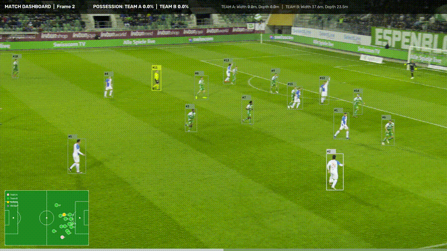

# FootVision AI

> Automated football match analysis from recorded video.

## 🎥 Demo



▶️ [Watch the full output video](outputs/SNMOT-062_phase14_ultimate.mp4)

## Project Overview

FootVision AI is a computer-vision pipeline that watches a recorded football match and automatically produces match statistics — player tracking, team separation, pitch mapping, possession estimation, and visualizations.

See [SPEC.md](SPEC.md) for the precise scope of Version 1.

---

## Accurate pipeline (v2)

The phase-by-phase scripts (below) were replaced by a single-pass pipeline in `src/pipeline/`
that is measured against SoccerNet-Tracking ground truth. The original runner is kept as
`scripts/run_pipeline_legacy.py`.

```
detect (cached) → track (BoT-SORT) → PTZ camera calibration → pitch coordinates
  → roles & teams → split tracks whose kit changes team → tracklet stitching → roles & teams
  → ball trajectory → smoothing → control / possession / passes → player & team statistics
```

### Accuracy on the SoccerNet test split (49 clips, never used for training or tuning)

| Metric | Original pipeline | v2 |
|---|---|---|
| Tracking HOTA | 0.44 | **0.65** |
| IDF1 (identity kept) | 0.49 | **0.79** |
| ID switches per 30 s clip | 141 | **42** |
| Team assignment | 82% | **97.6%** |
| Goalkeeper precision / recall | 27% / — | **90% / 84%** |
| Ball within 10 px | 46% | **70%** |
| Calibration: players projected at the right height (±25%) | — | **92%** |
| Distance covered, median error | — | **6.7%** |
| Pass F1 / turnover F1 | — | 0.66 / 0.51 |

Possession and passes have no human labels in SoccerNet; they are scored against the same
analytics run on ground-truth players and ball, so the numbers measure how much upstream errors
distort them.

### Data

Download SoccerNet-Tracking (`train.zip`, `test.zip`) and extract into
`data/SoccerNet/tracking/{train,test}/SNMOT-*`. Game 4 (`SNMOT-060`…`077`, train folder) is the
validation game: the detector is never trained on it and all tuning happens on it.

### Run on one sequence

```bash
python scripts/run_pipeline.py --seq_dir data/SoccerNet/tracking/train/SNMOT-062 --video
```

Writes `outputs/<seq>/` (`tracks.csv`, `ball.csv`, `possession.csv`, `events.csv`,
`player_stats.csv`, `team_metrics.csv`, `calibration.json`, `summary.json`), the legacy
`outputs/<seq>_phase*.csv` files used by the dashboard and, with `--video`, the broadcast video.
Calibration is automatic; `--homography` accepts an optional hand-picked first-frame homography.

### Detector

```bash
python scripts/prepare_yolo_dataset.py --src data/SoccerNet/tracking/train --out data/yolo_soccernet
python scripts/train_detector.py --model models/detection/yolo26s.pt --imgsz 1280 --epochs 4
```

Best weights go to `models/detection/fv_yolo26s_1280.pt` (classes: player, goalkeeper, referee,
ball). Validation mAP peaks around epoch 3; later epochs overfit.

### Evaluate and tune

```bash
# cache detections once (detection is ~95% of the compute)
python scripts/cache_detections.py --model models/detection/fv_yolo26s_1280.pt --tag ft1280 \
    --seqs "data/SoccerNet/tracking/test/SNMOT-*" --device mps
# full run + scores for many clips
python scripts/run_suite.py --seqs "data/SoccerNet/tracking/test/SNMOT-*" --out outputs_test --workers 3
# rerun game 4 with config overrides (reuses cached detections and calibration, ~4 min)
python scripts/tune_val.py --out runs/tune/my_try --set tracker.match_thresh=0.9 events.max_hold=50
# calibration stress test with overlays
python scripts/check_calibration.py --out runs/calib_check data/SoccerNet/tracking/test/SNMOT-116
# unit tests
python -m pytest tests/
```

`--set` takes dotted keys into `PipelineConfig` (`src/pipeline/run.py`). Tune on game 4 only and
score the test split once at the end.

---

## Requirements

| Tool | Version |
|---|---|
| Python | 3.12.x |
| CUDA (optional) | 12.1+ (NVIDIA GPU recommended) |
| Git | Any recent version |
| FFmpeg | Any recent version (for clip preparation) |

---

## Setup

### 1. Clone the repository

```bash
git clone <your-remote-url>
cd footvision-ai
```

### 2. Create a virtual environment

```bash
python -m venv .venv
```

Activate it:

- **Windows (PowerShell):** `.\.venv\Scripts\Activate.ps1`
- **Windows (CMD):** `.\.venv\Scripts\activate.bat`
- **Linux / macOS:** `source .venv/bin/activate`

### 3. Install dependencies

**With CUDA (NVIDIA GPU — recommended for this project):**

```bash
pip install torch torchvision --index-url https://download.pytorch.org/whl/cu121
pip install -r requirements.txt
```

**CPU only:**

```bash
pip install torch torchvision
pip install -r requirements.txt
```

### 4. Verify the setup

```bash
python -c "import cv2, torch, numpy; print('OpenCV:', cv2.__version__); print('PyTorch:', torch.__version__); print('CUDA:', torch.cuda.is_available())"
```

Expected output:
```
OpenCV: 4.x.x
PyTorch: 2.x.x+cu121
CUDA: True
```

---

## Project Structure

```
footvision-ai/
│
├── data/
│   ├── raw/              # Original unmodified video files (not committed)
│   ├── clips/            # Short extracted clips
│   ├── frames/           # Extracted frame images
│   ├── annotations/      # CVAT exports and manual labels
│   └── processed/        # Detection CSVs, JSONs
│
├── models/
│   ├── detection/        # Model weights
│   ├── tracking/         # Tracker configs
│   └── calibration/      # Homography matrices
│
├── notebooks/            # Jupyter notebooks for exploration
│
├── src/                  # All reusable source modules
│   ├── video/
│   ├── detection/
│   ├── tracking/
│   ├── teams/
│   ├── calibration/
│   ├── analytics/
│   └── visualization/
│
├── scripts/              # Standalone runnable scripts (one per phase task)
├── tests/                # Unit and integration tests
├── outputs/              # Annotated videos, figures, reports
├── config/               # Configuration files
│
├── requirements.txt
├── SPEC.md               # Phase 0: version 1 specification
└── README.md
```

---

## Phase 2 Scripts (Video Fundamentals)

Place a video file in `data/raw/` then run:

```bash
# Inspect video metadata
python scripts/phase2_video_metadata.py data/raw/your_clip.mp4

# Extract and save selected frames
python scripts/phase2_frame_extractor.py data/raw/your_clip.mp4

# Write an annotated output video with frame counter
python scripts/phase2_write_annotated_video.py data/raw/your_clip.mp4
```

---

## Development Philosophy

For every component, answer:

1. What is the input?
2. What is the output?
3. What assumptions does it make?
4. What are its likely failure cases?
5. How will I measure its quality?

Build one understandable component at a time, verify its output, then connect it to the next.

---

## Milestone Roadmap

| # | Milestone | Status | Output Deliverable |
|---|---|---|---|
| 0 | Project specification | ✅ | [SPEC.md](SPEC.md) |
| 1 | Development environment & structure | ✅ | Core repo, config schema, modules |
| 2 | Video fundamentals | ✅ | Metadata inspection, frame extraction, `SNMOT-062_annotated.mp4` |
| 3 | Manual bounding-box exercise | ✅ | Coordinate math, `outputs/phase3_manual_bbox.jpg` |
| 4 | Pretrained person detector | ✅ | YOLOv8n inference, multi-threshold study |
| 5 | Detection evaluation | ✅ | MOT IoU matching: 82.9% Precision, 82.3% Recall |
| 6 | Short-video detection | ✅ | Full sequence: 13,183 detections @ 9.4 FPS, CSV |
| 7 | Player tracking | ✅ | ByteTrack IDs, trajectory trails, CSV, 7.9 FPS |
| 8 | Team classification | ✅ | CIE-LAB K-Means + outlier rejection (Ref/GK), temporal voting |
| 9 | Pitch calibration & 2D radar | ✅ | Homography projection, side-by-side tactical radar, pitch coords CSV |
| 10 | Ball detection & tracking | ✅ | Dedicated ball pipeline & missing state tracking |
| 11 | Possession estimation | ✅ | Ball-to-player proximity & team possession timeline |
| 12 | Pass detection | ✅ | Completed passes, turnovers, pass network arrows |
| 13 | Player & team statistics | ✅ | Visible distance, team width/depth, heatmaps |
| 14 | Interactive Dashboard | ✅ | Streamlit match dashboard |
| 15 | Accuracy overhaul | ✅ | Ground-truth evaluation, fine-tuned detector, PTZ calibration, tuned tracking — see [Accurate pipeline (v2)](#accurate-pipeline-v2) |

---

## Running the Dashboard (Phase 14)

Once all pipeline phases have been executed and the `outputs/` folder is populated, you can launch the interactive web dashboard to explore the match analytics:

```bash
streamlit run app.py
```
Open the provided `localhost` URL in your browser.
